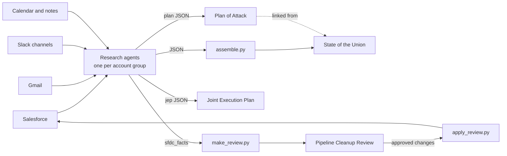

# Sales pages: State of the Union, Plans of Attack, JEPs and Pipeline Cleanup

A set of Claude Code skills and small Python builders for running a sales book from evidence. They
read Salesforce, email, Slack, the calendar and meeting notes, then publish five kinds of page:

| Page | Who reads it | Example (fake data) |
|---|---|---|
| **State of the Union** | AE and manager, weekly 1:1 | [pages/state-of-the-union.html](pages/state-of-the-union.html) |
| **Plan of Attack** | AE and exec sponsor, per account | [pages/northwind-analytics.html](pages/northwind-analytics.html) |
| **Joint Execution Plan** | Shared with the buyer, Stage 3+ | [pages/northwind-analytics-jep.html](pages/northwind-analytics-jep.html) |
| **Living Account Plan** | Execs, long-running accounts | [pages/contoso-ai-living-plan.html](pages/contoso-ai-living-plan.html) |
| **Pipeline Cleanup Review** | AE, before forecast | [pages/pipeline-cleanup-review.html](pages/pipeline-cleanup-review.html) |

**All data here is invented.** Northwind Analytics, Contoso AI and the rest are fictional companies,
and "Acme Search" is a fictional seller. No real customer, person, price or ID appears anywhere.

GitHub shows `.html` files as source. To view a page, download it and open it in a browser, or turn
on GitHub Pages for the repo.

## How it fits together



1. **Research.** Claude Code agents read each account's sources and return structured JSON. Every
   text field follows the writing rules: short sentences, no em dashes, only sourced facts. Each
   agent also returns a list of unknowns for the AE to resolve.
2. **Build.** The Python builders turn that JSON into a self-contained HTML page.
3. **Publish.** Pages go up as claude.ai artifacts at stable URLs. JEPs and the account index go to
   Google Drive as a Doc and a Sheet. `data/manifest.json` remembers every URL, so updates land in
   place and links never change.
4. **Maintain.** Each week, re-pull Salesforce, re-research only what moved, carry tasks forward, and
   republish to the same links.

## Try it with the example data

```bash
cd examples/sales-pages
python3 -I builders/build_sotu.py                                   # pages/state-of-the-union.html
builders/tools/qa_build.sh northwind-analytics                      # plan + JEP, checks writing rules
python3 -I builders/build_living_plan.py data/living/contoso-ai.json
python3 -I builders/build_review.py                                 # pages/pipeline-cleanup-review.html
```
Python 3.9+ with no extra packages. Publishing and research need Claude Code with Salesforce, Gmail,
Slack, Calendar and Drive connected, plus the `sf` CLI for applying cleanup changes.

## Use it on your own book

1. Copy `skills/state-of-the-union` and `skills/living-account-plan` into `~/.claude/skills/`.
2. Fill in the config table at the top of `skills/state-of-the-union/SKILL.md`: your name, manager,
   Salesforce owner ID, Slack user ID, company name and Drive folder.
3. Point the builders at your own `data/` folder. **Keep real data out of git.** Add your `data/`,
   `pages/` and `upload/` folders to `.gitignore`.
4. Ask Claude: "update my state of the union", "plan of attack for <account>", or "pipeline cleanup".

The skill files list every tool call: the SOQL queries, Gmail and Slack searches, calendar reads,
agent briefs, build commands and publish steps.

## What's in this folder

```
skills/
  state-of-the-union/SKILL.md          the full process (Parts 1-5) and config
  state-of-the-union/references/       agent briefs for research and for plans
  living-account-plan/SKILL.md         the 16-section living plan contract
builders/                              one Python file per page type
builders/tools/                        assemble, extract, QA, index, cleanup make/apply
styles/                                original CSS for the State of the Union and Plan of Attack
data/                                  fake example inputs
pages/                                 pages built from the fake inputs
```

## Notes
- The State of the Union and Plan of Attack layouts follow a colleague's internal pages. The styles in
  `styles/` are new and written for this repo. The original design is not included.
- On the State of the Union, task checkboxes save only in the viewer's browser. The Pipeline Cleanup
  Review saves decisions in the artifact's shared database, so they only save when it runs as a
  claude.ai artifact. Opened as a local file, it is read-only.
- `make_review.py` uses one org's custom Salesforce Sales Path field names. Replace them with yours.
