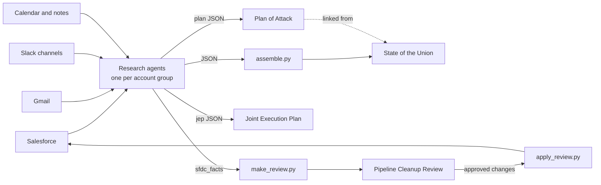

# Sales pages: State of the Union, Plans of Attack, JEPs and Pipeline Cleanup

A set of Claude Code skills and small Python builders for running a sales book from evidence. They
read Salesforce, email, Slack, the calendar and meeting notes, then publish five kinds of page:

| Page | Who reads it | See it live | Source |
|---|---|---|---|
| **State of the Union** | AE and manager, weekly 1:1 | [Open preview](https://raw.githack.com/andrewmiller-mckeever-star/andrew-pipeline/examples/sales-pages/examples/sales-pages/pages/state-of-the-union.html) | [html](pages/state-of-the-union.html) |
| **Plan of Attack** | AE and exec sponsor, per account | [Open preview](https://raw.githack.com/andrewmiller-mckeever-star/andrew-pipeline/examples/sales-pages/examples/sales-pages/pages/northwind-analytics.html) | [html](pages/northwind-analytics.html) |
| **Joint Execution Plan** | Shared with the buyer, Stage 3+ | [Open preview](https://raw.githack.com/andrewmiller-mckeever-star/andrew-pipeline/examples/sales-pages/examples/sales-pages/pages/northwind-analytics-jep.html) | [html](pages/northwind-analytics-jep.html) |
| **Living Account Plan** | Execs, long-running accounts | [Open preview](https://raw.githack.com/andrewmiller-mckeever-star/andrew-pipeline/examples/sales-pages/examples/sales-pages/pages/contoso-ai-living-plan.html) | [html](pages/contoso-ai-living-plan.html) |
| **Pipeline Cleanup Review** | AE, before forecast | [Open preview](https://raw.githack.com/andrewmiller-mckeever-star/andrew-pipeline/examples/sales-pages/examples/sales-pages/pages/pipeline-cleanup-review.html) | [html](pages/pipeline-cleanup-review.html) |

**All data here is invented.** Northwind Analytics, Contoso AI and the rest are fictional companies,
and "Acme Search" is a fictional seller. No real customer, person, price or ID appears anywhere.

"Open preview" renders the page in your browser through raw.githack.com, a free GitHub file viewer.
GitHub itself shows `.html` files as code. You can also download a file and open it locally. On the
Pipeline Cleanup Review, the approve buttons only save when the page runs as a claude.ai artifact.

## How it fits together



1. **Research.** Claude Code agents read each account's sources and return structured JSON. Every
   text field follows the writing rules: short sentences, no em dashes, only sourced facts. Each
   agent also returns a list of unknowns for the AE to resolve.
2. **Build.** The Python builders turn that JSON into a self-contained HTML page.
3. **Publish.** Pages go up as claude.ai artifacts at stable URLs. JEPs and the account index go to
   Google Drive as a Doc and a Sheet. `data/manifest.json` remembers every URL, so updates land in
   place and links never change.
4. **Maintain.** Each week, re-pull Salesforce, re-research only what moved, carry tasks forward, and
   republish to the same links.

## Before you start

| You need | Required? | Used for |
|---|---|---|
| [Claude Code](https://claude.com/claude-code) | Yes | Runs the skills and the research agents |
| Python 3.9+ | Yes | The builders. No extra packages. |
| Salesforce connector (read) | Yes | Opps, contacts, activity, stage history |
| Gmail connector | Yes | Last real contact, pricing and contract threads |
| Slack connector | Yes | Account channels, deal desk, legal threads |
| Google Calendar connector | Recommended | Booked meetings |
| Google Drive connector + [rclone](https://rclone.org/drive/) | Recommended | Joint Execution Plans as Google Docs, the index as a Sheet |
| A meeting-notes connector (Granola or similar) | Optional | Call notes for "Why we're stuck" and tasks |
| A web search tool | Optional | Public news and funding for "Top of mind" |
| claude.ai account with artifacts | Optional | Publishing pages at stable links (otherwise open the HTML files) |
| Salesforce [`sf` CLI](https://developer.salesforce.com/tools/salesforcecli), signed in as you | Optional | Applying approved cleanup changes |

Connectors are added in Claude Code. In the Code tab of the Claude desktop app, use the connector
settings. In the terminal, use `/mcp`.

**Your Salesforce will be different.** These skills were written against one company's org. The
briefs read API usage from a custom `Product_User__c` object and `Account.Domain__c`. The cleanup tool
uses that org's custom Sales Path fields and stage names like `1 - Discovery`. When you first run it,
tell Claude: "This came from another org. Check my Salesforce schema and adapt the field names, usage
object and stage names to mine." Claude can read your schema with the Salesforce connector and make the
swaps.

## First run, step by step

1. **See the examples.** Open the five previews above so you know what you're building.
2. **Get the files.**
   ```bash
   git clone --branch examples/sales-pages https://github.com/andrewmiller-mckeever-star/andrew-pipeline.git
   cd andrew-pipeline/examples/sales-pages
   ```
3. **Build the examples locally** to confirm Python works:
   ```bash
   python3 -I builders/build_sotu.py
   builders/tools/qa_build.sh northwind-analytics
   ```
   Open `pages/state-of-the-union.html` in a browser.
4. **Install the skills.**
   ```bash
   mkdir -p ~/.claude/skills
   cp -R skills/state-of-the-union skills/living-account-plan ~/.claude/skills/
   ```
5. **Make your own workspace** so your real data never lands in git:
   ```bash
   mkdir -p ~/sales-pages && cp -R builders styles ~/sales-pages/ && mkdir -p ~/sales-pages/{data/plans,data/research,data/living,pages,upload}
   echo '{"plans": {}, "jeps": {}}' > ~/sales-pages/data/manifest.json
   ```
6. **Open Claude Code in `~/sales-pages`** and fill in the config. Tell Claude:
   > "Open ~/.claude/skills/state-of-the-union/SKILL.md and fill in the config table for me. My name is …, my manager is …, my company is … Look up my Salesforce user ID and my Slack user ID."
7. **Adapt it to your Salesforce** (see above):
   > "This skill came from another org. Check my Salesforce schema and adapt the briefs and builders to my field names, usage data and stage names."
8. **Build your first Plan of Attack** on one account you know well, so you can check the output:
   > "Plan of attack for <account>. Depth: FULL."

   Read the agent's list of unknowns, fix anything wrong in `data/plans/<slug>.json`, and rerun
   `builders/tools/qa_build.sh <slug>`.
9. **Build your State of the Union:**
   > "Update my state of the union. My year target is $… and my quota by quarter is …"

   Claude runs the research agents, assembles the data and builds `pages/state-of-the-union.html`. If
   you have claude.ai artifacts, it publishes the page and saves the link in `data/manifest.json`.
10. **Optional extras:**
    > "Joint close plan for <account>" for any deal at Stage 3 or later.
    > "Build the account index sheet" for a Google Sheet of every plan link.
    > "Pipeline cleanup" for proposed Salesforce fixes to approve.
11. **Every week before your 1:1:**
    > "Update my state of the union."

    Claude re-pulls Salesforce, re-researches only what moved, and republishes to the same links.

## What's in this folder

```
skills/
  state-of-the-union/SKILL.md          the full process (Parts 1-5) and config
  state-of-the-union/references/       agent briefs for research and for plans
  living-account-plan/SKILL.md         the 16-section living plan contract
builders/                              one Python file per page type
builders/tools/                        assemble, extract, QA, index, cleanup make/apply
styles/                                original CSS for the State of the Union and Plan of Attack
data/                                  fake example inputs
pages/                                 pages built from the fake inputs
```

## Notes
- The State of the Union and Plan of Attack layouts follow a colleague's internal pages. The styles in
  `styles/` are new and written for this repo. The original design is not included.
- On the State of the Union, task checkboxes save only in the viewer's browser.
- These examples are a frozen snapshot. The skill files are the source of truth for the full process.
